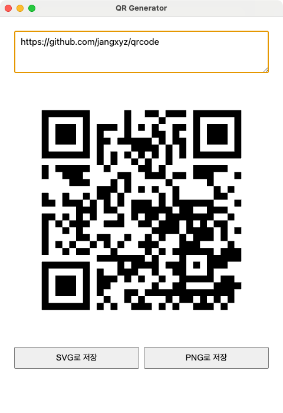

# qrcode

[English](README.md) | 한국어

텍스트나 URL을 입력받아 QR 코드를 만들고 SVG나 PNG 파일로 저장하는 도구다. 서버 없이 로컬에서만 돈다.

같은 기능을 여러 기술 스택으로 만들어 비교하는 저장소라, 구현마다 디렉토리를 따로 두고 각 디렉토리를 독립된 프로젝트로 빌드·실행한다.

| 디렉토리 | 스택 | 제공하는 것 |
| --- | --- | --- |
| [`electron-ts/`](electron-ts/) | Electron + TypeScript | desktop 앱, `qr-gen` CLI |

## electron-ts



Node 22.18 이상이 필요하다. CLI가 TypeScript 파일을 빌드 없이 Node로 바로 실행하기 때문이다.

```sh
cd electron-ts
npm install
```

### desktop 앱

```sh
npm run dev
```

입력창에 텍스트를 넣으면 QR 코드가 바로 미리보기로 그려지고, "SVG로 저장"과 "PNG로 저장" 버튼으로 파일을 저장한다. 내용이 QR 코드에 담을 수 있는 길이를 넘으면 안내 문구가 뜬다.

앱 문구는 영어와 한국어를 지원하고, 시스템의 첫 번째 선호 언어를 따른다. 언어를 직접 고르려면 `open -a "QR Generator" --args --lang=ko`처럼 `--lang`을 주고 띄운다. 앱이 이미 떠 있으면 먼저 종료해야 한다.

### qr-gen CLI

```sh
npm run qr-gen -- "hello"                          # 터미널에 QR 코드를 그린다
npm run qr-gen -- "https://example.com" -o a.svg   # SVG로 저장한다
echo -n "텍스트" | npm run qr-gen -- -o a.png       # stdin으로 받아 PNG로 저장한다
```

`-o`를 주지 않으면 파일을 만들지 않고 터미널에 그린다. 저장 형식은 `-o`에 준 파일의 확장자(`.svg`, `.png`)로 정해진다.

어느 디렉토리에서든 `qr-gen`으로 실행하려면 `electron-ts/`에서 `npm link`를 한 번 실행한다. 프로젝트 파일을 가리키는 링크라서 코드를 고치면 바로 반영된다. 지울 때는 패키지 이름으로 `npm rm -g qr-gen`을 실행한다.

GUI와 CLI는 같은 생성 모듈(`src/main/qr.mts`)을 쓰므로 같은 입력이면 같은 QR 코드가 나온다.

## 라이선스

[MIT](LICENSE)
